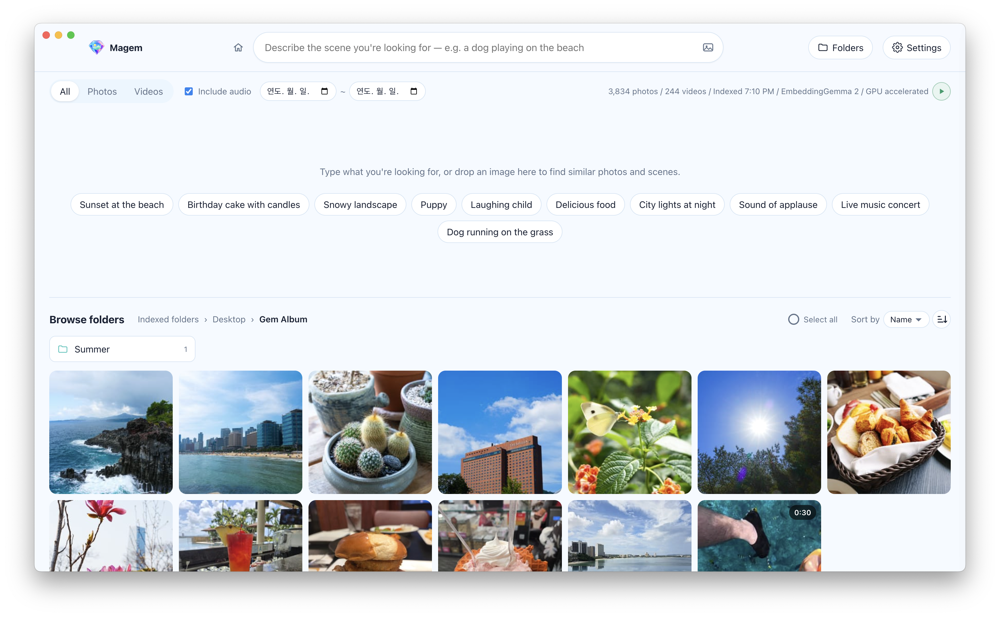

<p align="center"></p>

<h1 align="center">Magem</h1>

<p align="center">
  <b>An AI-powered gallery app that runs entirely on your computer, no internet needed</b><br>
  Describe it in words, and it finds the gem of a scene among thousands of photos and videos.
</p>

<p align="center"><a href="https://github.com/Kokyung/Magem/releases"><b>Download (macOS, Windows)</b></a></p>

<p align="center"><a href="README.md">한국어</a> · <b>English</b> · <a href="README.ja.md">日本語</a> · <a href="README.zh-CN.md">简体中文</a> · <a href="README.zh-TW.md">繁體中文</a></p>

<p align="center"></p>

## Highlights

- 🔒 **Fully offline**: the AI model (Google EmbeddingGemma 2) ships inside the app.
- 🛡️ **Private**: your photos never leave your computer. No account, no server, no cloud upload.
- 🧠 **Search by content, not file names**: it understands the scenes in photos and videos and the sound in videos.
- ⚡ **Install and run**: no Python, Ollama or API key needed. Uses your GPU automatically when available.
- 🌏 **17 languages**

## Features

| Feature | Description |
|---|---|
| 🔎 **Search with a sentence** | Describe the scene you're looking for |
| 📅 **Search by capture date** | Pick a date range to search only photos and videos taken in it |
| 🖼️ **Search with an image** | Button, drag and drop (web images too) or paste. Add words to narrow it down |
| 🔊 **Find sounds in videos** | Search by speech, music or ambient sound. Plays from the moment it found |
| 📁 **Browse folders** | Explore folders without a search. Sort by name or modified date |
| 🧩 **Find similar** | Pick a photo and find similar photos and scenes |
| 🔄 **Automatic indexing** | Processes only new and changed files and drops deleted ones. Exclude subfolders, pause with ▶/⏸ |
| 💾 **Index backup & restore** | Save the index and thumbnails as one `.magem` file and bring them back |
| ⚙️ **Settings** | 17 languages, system/light/dark theme |

<details>
<summary>Search results and indexing in detail</summary>

- **Search results**: "File & folder names" shows items whose names match the search at the top, and below it "Scenes · Audio"
  shows items with similar scenes and sound (when "Include audio" is on). Each file appears in only one of the two.
- **Relevance (%)**: a 0–100% value calibrated per search type. Results under 40% are hidden.
- **Capture date**: photos use the EXIF capture time and videos the creation time recorded in the file; if neither exists
  (screenshots, for example), the file's modified date is used. Picking only a date range lists the items in it, newest first.
- **Recent searches**: the last 10 are shown, and you can remove them one by one or all at once.
- **Indexing**: file-name analysis runs first, then photo and video indexing, with the time left shown while it runs.
  New files are checked when the app starts and when you come back to the window from another app (every 30 s at most).
  Paused with ⏸, it stays paused until you press ▶.
- **Language**: follows the OS language at first, and starts in English if that language isn't in the list.
  Error messages are always shown in English.
- **Supported languages**: English, Korean, Japanese, Chinese (Simplified, Traditional), Spanish (Spain, Latin America),
  French, Italian, German, Russian, Ukrainian, Polish, Turkish, Hungarian, Czech, Arabic
- **Copying videos**: videos have no "Copy to clipboard" (copy as image). The clipboard has no common format for video,
  so use "Copy file" to paste one into a messenger or file manager.
- **When the file selection clears**: after the selected files are copied successfully, when you press Esc, and when the search,
  filters or the folder you're viewing change.

</details>

## Installation

**[Download the installer](https://github.com/Kokyung/Magem/releases)**

| Platform | Installer | Status |
|---|---|---|
| macOS (Apple Silicon) | `Magem-<version>-mac-arm64.dmg` | Built and tested |
| Windows (x64 / ARM64) | `Magem-<version>-win.exe` | Built and tested |
| Linux (x64) | `Magem-<version>-linux-x86_64.AppImage`, `Magem-<version>-linux-amd64.deb` | Build config only (must be built on Linux, untested) |

- Intel Macs aren't supported, because onnxruntime doesn't ship native binaries for Intel Macs.
- The build is ad-hoc signed without a developer certificate, so Gatekeeper warns the first time it's installed on another Mac.
  **Right-click the app in Finder → Open** once. (The Mac that built it shows no warning.)
- For the same reason, macOS asks for folder access again after every update. With an ad-hoc signature the hash of the app's
  contents is its identity, so a new version is seen as a different app. Signing with a Developer ID certificate removes this.
- The Windows installer isn't code-signed either, so SmartScreen may warn on the first run.
  Click **More info → Run anyway**.

## Size limits

| Item | Limit | When exceeded |
|---|---|---|
| Photos to index | About 268 megapixels (e.g. 16,384 × 16,384) | Not indexed; listed under "Files that couldn't be processed" in the folders panel |
| Search with an image (pick, drag, paste) | 64 MB | Search fails with a message |
| Image dragged from a web browser | 25 MB, 20 s download | Shows an error such as "The image is too large" |
| Copy files (multi-select) | 10,000 at a time | Shows a notice and keeps the selection |
| Copy a photo to the clipboard | 8,192 px on the long side | Larger ones are scaled to 8,192 px when copied (the original file is untouched) |

- The pixel limit is the image library's (sharp) default safeguard. Regular camera and phone photos (100 MP class or less) aren't affected.
- Videos have no file-size limit. Instead, at most 120 frames are indexed, every 2–30 seconds depending on length.

## Architecture

```
electron/main.mjs      Window, folder picker, Finder integration, clipboard, file drag, system tray, launch at login (main process)
electron/index-backup.mjs  Index backup (.magem) and restore; a restore is swapped in on the next launch, before the engine starts
electron/preload.cjs   Minimal API exposed to the renderer
                       Screen: pickFolders, setTheme, systemLanguages
                       Files: reveal, revealFolder, openFile, copyImage, copyFiles, copyPaths, startFileDrag, pathForFile
                       Backup: startBackup, startRestore, cancelIndexJob, getIndexJob, revealBackup, onIndexJob
                       App settings: getAppSettings, setOpenAtLogin, setRunInBackground, setTrayLabels, onOpenSettings
backend/               Search engine (runs in an Electron utilityProcess)
  embedder.mjs         EmbeddingGemma 2 ONNX — transformers.js + onnxruntime-node
  media.mjs            Photo, video and audio decoding (sharp, ffmpeg-static, macOS sips, heic-decode)
  indexer.mjs          Folder scan, indexing, vector search, time-left estimate (node:sqlite)
  server.mjs           127.0.0.1 HTTP API + UI (protected by a token cookie that changes on every launch)
  db-check.mjs         Checks the index of a backup being restored (integrity, tables, thumbnail names)
static/                UI (HTML/CSS/JS); UI text for 17 languages in i18n.js
build/                 App icon (generated from icon-source.png with npm run make-icons)
models/                Model files bundled with the app (downloaded automatically on npm install)
```

### Embedding engine
- The model is `onnx-community/embeddinggemma-2-ONNX` (Apache 2.0).
  Text and vision run at fp16 and audio at q8; it takes about 1.2 GB in the app.
- It tries the GPU first and falls back to the CPU automatically.
  - macOS/Linux: WebGPU → CPU
  - Windows: WebGPU → DirectML → CPU
  - Force the CPU with `MMF_DEVICE=cpu`.
- Speed (measured on an M2 Pro): about 0.55 s per photo with WebGPU, about 2.8 s on the CPU alone.
- Videos are embedded as frames every 2–30 seconds (up to 120) and 15-second audio chunks.
  Silent chunks are skipped.
- Text search subtracts how similar each vector is to generic queries (the baseline),
  then drops results under 40% relevance.
- File and folder names are embedded in the `title: … | text: …` document format.
  The score is semantic similarity plus a keyword match (the share of search words found in the name × 0.2),
  because semantic scores alone can bury exact-word searches like "INFP".
- macOS stores Korean file names in decomposed NFD form, so names and queries are normalized to NFC before comparing.

### Data location
The index (SQLite) and thumbnails are stored in the app data folder.

| Platform | Path |
|---|---|
| macOS | `~/Library/Application Support/Magem/` |
| Windows | `%APPDATA%\Magem\` |
| Linux | `~/.config/Magem/` |

Logs are kept in `logs/` in the same folder.

- `engine.log`: search engine log (the previous run in `engine.prev.log`)
- `main.log`: renderer, GPU and network process exits and automatic recovery, sleep and wake (cumulative)

## Development / build

Requires Node.js 22.12 or later.

```bash
npm install          # Install dependencies + download the model (about 1.2 GB)
npm start            # Run in development mode
npm run dist:mac     # macOS DMG  → dist/
npm run dist:win     # Windows installer for x64 and ARM64 (run on Windows; downloads the ARM64 ffmpeg first)
npm run dist:linux   # AppImage / deb (run on Linux)
npm run make-icons   # Regenerate the app icon and title logo (static/logo.png) from build/icon-source.png
```

### Getting the model (EmbeddingGemma 2)

The model files aren't in the repository (`models/` is in `.gitignore`). After `npm install` finishes,
`scripts/fetch-model.mjs` runs automatically and downloads only the files needed from Hugging Face.
No login or token is required.

```
models/
├─ embeddinggemma-2-ONNX/   onnx-community/embeddinggemma-2-ONNX (about 1.2 GB)
│  ├─ config.json, tokenizer.json and other config files
│  └─ onnx/  model_fp16 · vision_encoder_fp16 · audio_encoder_quantized (.onnx + .onnx_data)
```

- If the download was interrupted or files are missing, run `npm run fetch-model` again.
  Files already downloaded are skipped by comparing sizes, and files with a different size are downloaded again.
- If you installed with `npm install --ignore-scripts`, the automatic download doesn't run, so run `npm run fetch-model` yourself.
- The app never downloads the model at runtime and uses only the `models/` folder. This folder goes into the installer
  as is at build time, so the model must be ready before building.
- The file list and precisions (fp16, q8) match `DTYPE` in `backend/embedder.mjs`.
  If you change a precision, change `FILES` in `scripts/fetch-model.mjs` too.

### Building per platform

Each platform's installer must be built on that OS,
because the native modules (onnxruntime-node, sharp) and the ffmpeg binary are installed for the OS doing the build.

For Windows ARM64, `scripts/fetch-ffmpeg.mjs` downloads a pinned BtbN build and checks its SHA-256.
BtbN deletes old builds, so if the pinned build is gone, use one of these.

```bash
FFMPEG_WINARM64_URL=<mirror of the same zip> npm run fetch-ffmpeg   # SHA-256 check still applies
node scripts/fetch-ffmpeg.mjs --latest                             # Latest BtbN LGPL build (no pinned hash)
```

## License

Copyright 2026 Kokyung Byun

| Component | License | Notes |
|---|---|---|
| Magem | Apache-2.0 | [LICENSE](LICENSE) |
| EmbeddingGemma 2 model | Apache-2.0 | |
| ffmpeg (macOS, Windows x64, Linux) | GPL-3.0 | Run as a separate program · GPL terms apply when redistributing · [Source](https://ffmpeg.org/download.html) |
| ffmpeg (Windows ARM64) | LGPL | BtbN build · version and SHA-256 pinned in `scripts/fetch-ffmpeg.mjs` |
| Other libraries | Their own licenses | [THIRD_PARTY_NOTICES.md](THIRD_PARTY_NOTICES.md) |
