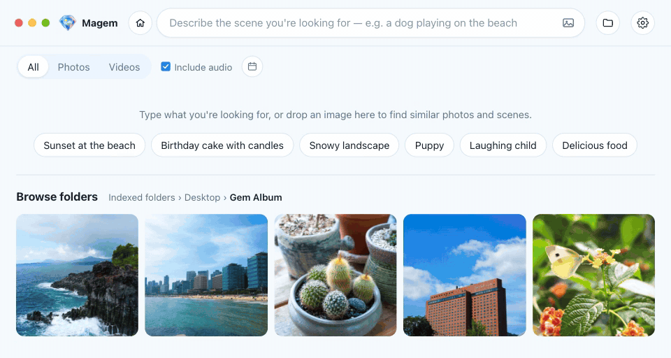

<p align="center"></p>

<h1 align="center">Magem</h1>

<p align="center">
  <b>An AI-powered gallery app that runs entirely on your computer, no cloud needed</b><br>
  Describe it in words, and it finds the gem of a scene among thousands of photos and videos.
</p>

<p align="center"><a href="https://github.com/Kokyung/Magem/releases"><b>Download (macOS, Windows)</b></a></p>

<p align="center"><a href="README.md">한국어</a> · <b>English</b> · <a href="README.ja.md">日本語</a> · <a href="README.zh-CN.md">简体中文</a> · <a href="README.zh-TW.md">繁體中文</a></p>

<p align="center"></p>

## Highlights

- 🔒 **Fully local**: the AI model (Google EmbeddingGemma 2) ships inside the app.
- 🛡️ **Private**: your photos never leave your computer. No account, no server, no cloud upload.
- 🧠 **Understands scenes and sound**: it understands the scenes in photos and videos and the sound in videos.
- ⚡ **Install and run**: no Python, Ollama or API key needed.
- 🌏 **17 languages**

## Features

| Feature | Description |
|---|---|
| 🔎 **Search with a sentence** | Describe the scene you're looking for |
| 📅 **Search by capture date** | Pick a date range on the calendar, or a preset (today, last 7 days, last 30 days, this year, last year), and apply it to search only photos and videos taken then |
| 🖼️ **Search with an image** | Button, drag and drop (web images too) or paste. Add words to narrow it down |
| 🔊 **Find sounds in videos** | Search by speech, music or ambient sound. Plays from the moment it found |
| 📁 **Browse folders** | Explore folders without a search. Sort by name or modified date. Files not indexed yet can be previewed and viewed in the viewer too |
| 🧩 **Find similar** | Pick a photo and find similar photos and scenes |
| 🔍 **Viewer** | Zoom and pan photos, full screen, previous/next item (buttons and arrow keys), video autoplay |
| 🔄 **Automatic indexing** | Processes only new and changed files and drops deleted ones. Notices changes in the folders even with the window closed. Exclude subfolders, pause with ▶/⏸ |
| 🔋 **Indexing performance** | Power saving, balanced or maximum performance, separately while in use and in the background; pause on battery |
| 💾 **Index backup & restore** | Save the index and thumbnails as one `.magem` file and bring them back |
| ⚙️ **Settings** | 17 languages, system/light/dark theme, video autoplay, launch at startup and start in the background, run in the background (Windows) |

<details>
<summary>Search results and indexing in detail</summary>

- **Search results**: "File & folder names" shows items whose names match the search at the top, and below it "Scenes · Audio"
  shows items with similar scenes and sound (when "Include audio" is on). Each file appears in only one of the two.
- **Relevance (%)**: a 0–100% value calibrated per search type. Results under 40% are hidden.
- **Capture date**: photos use the EXIF capture time and videos the creation time recorded in the file; if neither exists
  (screenshots, for example), the file's modified date is used. Picking only a date range lists the items in it, newest first.
- **Recent searches**: the last 10 are shown, and you can remove them one by one or all at once.
- **Indexing**: file-name analysis runs first, then photo and video indexing. Progress shows as a ring around the ▶/⏸ button with a
  percentage; hover over the button for the details (time left, the file in hand, counts). New files are checked at launch, and while
  the app runs it watches the indexed folders and indexes files as they are added, changed or deleted (once changes have been quiet for
  5 seconds, or within 60 seconds while they keep coming). This works with the window closed too, and then a notification says when
  there are files to index. Paused with ⏸, indexing stays paused until you press ▶.
- **Indexing performance**: choose power saving, balanced or maximum performance separately for while you use the app (Default indexing)
  and for when no window is shown or it is minimized (Indexing in the background). The defaults are balanced and power saving, and
  Pause indexing on battery is on.
- **Running in the background**: on Windows, closing the window leaves the app in the system tray, still indexing; the tray menu opens the
  app or its settings, starts or pauses indexing, and quits. On macOS, closing the window leaves the app in the Dock, still indexing; the
  Dock icon's menu starts or pauses indexing.
- **Files not indexed yet**: folder browsing shows them too, marked "Waiting to be indexed", with a preview thumbnail, and opens them in
  the viewer. Previews are made only for the files on screen and deleted once the files are indexed.
- **Folder counts**: the number on a folder button is how many photos and videos are under that folder now (subfolders included), indexed or not.
- **Indexed folders menu**: the indexed and excluded folders can be shown as a list or a grid.
- **Language**: follows the OS language at first, and starts in English if that language isn't in the list.
  Error messages are always shown in English.
- **Supported languages**: English, Korean, Japanese, Chinese (Simplified, Traditional), Spanish (Spain, Latin America),
  French, Italian, German, Russian, Ukrainian, Polish, Turkish, Hungarian, Czech, Arabic
- **Copying videos**: videos have no "Copy to clipboard" (copy as image). The clipboard has no common format for video,
  so use "Copy file" to paste one into a messenger or file manager.
- **When the file selection clears**: after the selected files are copied successfully, when you press Esc, and when the search,
  filters or the folder you're viewing change.

</details>

## Installation

**[Download the installer](https://github.com/Kokyung/Magem/releases)**

| Platform | Installer | Status |
|---|---|---|
| macOS (Apple Silicon) | `Magem-<version>-mac-arm64.dmg` | Built and tested |
| Windows (x64) | `Magem-<version>-win-x64.exe` | Built and tested |
| Windows (ARM64) | `Magem-<version>-win-arm64.exe` | Build config only (build test needed) |
| Linux (x64) | `Magem-<version>-linux-x86_64.AppImage`, `Magem-<version>-linux-amd64.deb` | Build config only (build test needed) |

<details>
<summary>Limitations</summary>

- Intel Macs aren't supported, because onnxruntime doesn't ship native binaries for Intel Macs.
- The build is ad-hoc signed without a developer certificate, so Gatekeeper warns the first time it's installed on another Mac.
  **Right-click the app in Finder → Open** once. (The Mac that built it shows no warning.)
- For the same reason, macOS asks for folder access again after every update. With an ad-hoc signature the hash of the app's
  contents is its identity, so a new version is seen as a different app. Signing with a Developer ID certificate removes this.
- For the same reason, background-indexing notifications don't show on macOS: macOS doesn't allow notifications from ad-hoc signed apps.
  (On Windows they show at the bottom right of the screen.)
- The Windows installer isn't code-signed either, so SmartScreen may warn on the first run.
  Click **More info → Run anyway**.

</details>

## Documentation

- [Size limits](docs/LIMITS.en.md): limits on indexing, searching and copying
- [Architecture](docs/ARCHITECTURE.en.md): code layout, embedding engine, where data and logs are kept

## Development / build

Requires Node.js 22.12 or later.

```bash
npm install          # Install dependencies + download the model (about 1.2 GB)
npm start            # Run in development mode
npm run dist:mac     # macOS DMG  → dist/
npm run dist:win:x64   # Windows x64 installer (run on Windows)
npm run dist:win:arm64 # Windows ARM64 installer (run on Windows; downloads the ARM64 ffmpeg first)
npm run dist:win       # Both installers above, one after the other
npm run dist:linux   # AppImage / deb (run on Linux)
npm run make-icons   # Regenerate the app icon and title logo (static/logo.png) from build/icon-source.png
```

Build the Windows installers **on Windows**. sharp, ONNX Runtime and ffmpeg use a different binary for each OS and CPU, and `npm install` only installs the ones for the computer it runs on, so a Windows installer made on macOS contains macOS binaries and doesn't work.

To build the ARM64 installer on an x64 PC, first install the ARM64 sharp (ONNX Runtime comes with both CPUs, and `dist:win:arm64` downloads the ffmpeg):

```bash
npm install --no-save --os=win32 --cpu=arm64 sharp
```

### Getting the model (EmbeddingGemma 2)

The model files aren't in the repository (`models/` is in `.gitignore`). After `npm install` finishes,
`scripts/fetch-model.mjs` runs automatically and downloads only the files needed from Hugging Face.
No login or token is required.

```
models/
├─ embeddinggemma-2-ONNX/   onnx-community/embeddinggemma-2-ONNX (about 1.2 GB)
│  ├─ config.json, tokenizer.json and other config files
│  └─ onnx/  model_fp16 · vision_encoder_fp16 · audio_encoder_quantized (.onnx + .onnx_data)
```

- If the download was interrupted or files are missing, run `npm run fetch-model` again.
  Files already downloaded are skipped by comparing sizes, and files with a different size are downloaded again.
- If you installed with `npm install --ignore-scripts`, the automatic download doesn't run, so run `npm run fetch-model` yourself.
- The app never downloads the model at runtime and uses only the `models/` folder. This folder goes into the installer
  as is at build time, so the model must be ready before building.
- The file list and precisions (fp16, q8) match `DTYPE` in `backend/embedder.mjs`.
  If you change a precision, change `FILES` in `scripts/fetch-model.mjs` too.

### Building per platform

Each platform's installer must be built on that OS,
because the native modules (onnxruntime-node, sharp) and the ffmpeg binary are installed for the OS doing the build.

For Windows ARM64, `scripts/fetch-ffmpeg.mjs` downloads a pinned BtbN build and checks its SHA-256.
BtbN deletes old builds, so if the pinned build is gone, use one of these.

```bash
FFMPEG_WINARM64_URL=<mirror of the same zip> npm run fetch-ffmpeg   # SHA-256 check still applies
node scripts/fetch-ffmpeg.mjs --latest                             # Latest BtbN LGPL build (no pinned hash)
```

## FAQ

<details>
<summary><b>Do I need an internet connection?</b></summary>

No. The AI model ships inside the app, so every basic feature, indexing, searching and previews included, works without a connection.
Some experimental features may need one, but the app works the same without them.
Dragging an image in from a web page downloads that image to search with it.
Your photos and videos are never uploaded, in any case.

</details>

<details>
<summary><b>Will my files be changed or deleted?</b></summary>

No. Magem only reads your photos and videos; it never changes or deletes them.
The index, thumbnails and previews are kept apart from them, in the app data folder.
Removing a folder from the list or excluding one only takes it out of the index; the original files stay where they are.

</details>

## License

Copyright 2026 Kokyung Byun

| Component | License | Notes |
|---|---|---|
| Magem | Apache-2.0 | [LICENSE](LICENSE) |
| EmbeddingGemma 2 model | Apache-2.0 | |
| ffmpeg (macOS, Windows x64, Linux) | GPL-3.0 | Run as a separate program · GPL terms apply when redistributing · [Source](https://ffmpeg.org/download.html) |
| ffmpeg (Windows ARM64) | LGPL | BtbN build · version and SHA-256 pinned in `scripts/fetch-ffmpeg.mjs` |
| Other libraries | Their own licenses | [THIRD_PARTY_NOTICES.md](THIRD_PARTY_NOTICES.md) |
