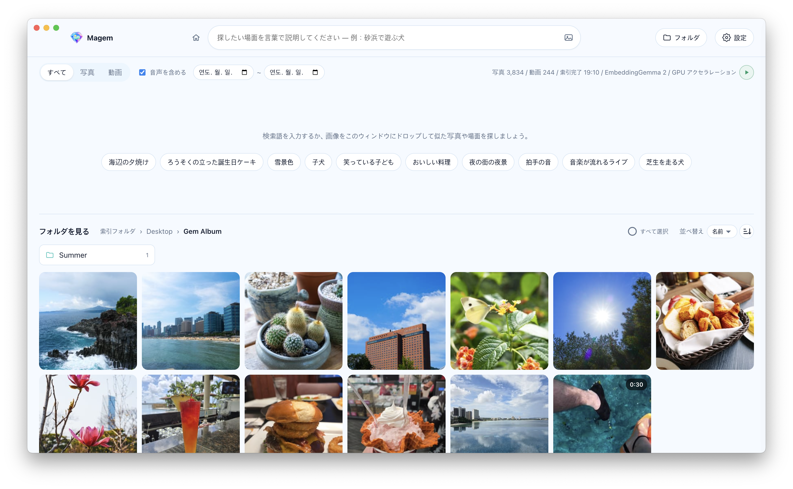

<p align="center"></p>

<h1 align="center">Magem</h1>

<p align="center">
  <b>インターネットなしで自分のパソコンだけで動く AI ギャラリーアプリ</b><br>
  言葉で説明するだけで、何千枚もの写真や動画の中から宝石のような場面をすぐに見つけます。
</p>

<p align="center"><a href="https://github.com/Kokyung/Magem/releases"><b>ダウンロード（macOS、Windows）</b></a></p>

<p align="center"><a href="README.md">한국어</a> · <a href="README.en.md">English</a> · <b>日本語</b> · <a href="README.zh-CN.md">简体中文</a> · <a href="README.zh-TW.md">繁體中文</a></p>

<p align="center"></p>

## 特長

- 🔒 **完全オフライン**：AI モデル（Google EmbeddingGemma 2）がアプリに内蔵されています。
- 🛡️ **プライバシー保護**：写真がパソコンの外に出ることはなく、アカウント・サーバー・クラウドへのアップロードもありません。
- 🧠 **ファイル名ではなく内容で検索**：写真や動画の場面、動画の音声を理解して探します。
- ⚡ **インストールしてすぐ使える**：Python、Ollama、API キーは不要です。GPU があれば自動で高速化します。
- 🌏 **17 言語に対応**

## 機能

| 機能 | 説明 |
|---|---|
| 🔎 **文章で検索** | 探したい場面を文章で説明 |
| 📅 **撮影日で検索** | 日付の範囲を選ぶと、その期間に撮った写真・動画だけを検索 |
| 🖼️ **画像で検索** | ボタン、ドラッグ＆ドロップ（Web 画像も可）、貼り付け。文字を加えて絞り込み |
| 🔊 **動画の音声を探す** | 会話、音楽、環境音で検索。見つかった場面の時点からすぐ再生 |
| 📁 **フォルダを閲覧** | 検索語なしでフォルダを探索。名前・更新日で並べ替え |
| 🧩 **似たものを探す** | 写真を 1 枚選んで、似た写真や場面を探す |
| 🔄 **自動インデックス** | 新しいファイルと変更されたファイルだけを処理し、削除されたファイルはインデックスから整理。サブフォルダの除外、▶/⏸ で一時停止 |
| 💾 **インデックスのバックアップ・復元** | インデックスとサムネイルを 1 つの `.magem` ファイルに保存して元に戻す |
| ⚙️ **設定** | 17 言語、システム・ライト・ダークテーマ |

<details>
<summary>検索結果とインデックスの詳細</summary>

- **検索結果**：「ファイル・フォルダ名」に検索語と一致する項目を一番上に、その下の「場面・音声」に場面や音声（「音声を含める」がオンの場合）が
  似ている項目を表示します。1 つのファイルはどちらか一方にだけ表示されます。
- **関連度（%）**：検索方式ごとに補正した 0〜100% の値で、40% 未満の結果は表示しません。
- **撮影日**：写真は EXIF の撮影日時、動画はファイルに記録された作成日時を使い、どちらもない場合（スクリーンショットなど）はファイルの更新日を使います。
  検索語なしで日付だけを選ぶと、その期間の項目を新しい順に表示します。
- **最近の検索**：直近 10 件を表示し、1 件ずつまたはすべて削除できます。
- **インデックス**：ファイル名の解析 → 写真・動画のインデックスの順に進み、インデックス中は残り時間を表示します。
  アプリの起動時と、他のアプリからウィンドウに戻ったとき（最短 30 秒間隔）に新しいファイルを確認します。⏸ で止めると ▶ を押すまで止まったままです。
- **言語**：最初は OS の言語に従い、一覧にない言語の場合は英語で始まります。エラーメッセージは言語に関係なく英語で表示します。
- **対応言語**：英語、韓国語、日本語、中国語（簡体字・繁体字）、スペイン語（スペイン・中南米）、フランス語、イタリア語、ドイツ語、
  ロシア語、ウクライナ語、ポーランド語、トルコ語、ハンガリー語、チェコ語、アラビア語
- **動画のコピー**：動画には「クリップボードにコピー」（画像としてコピー）がありません。クリップボードには動画を扱う共通形式がないため、
  メッセンジャーやエクスプローラーに貼り付けるには「ファイルをコピー」を使ってください。
- **ファイルの選択が解除される場合**：選択したファイルのコピーに成功したとき、Esc を押したとき、検索語・フィルター・表示中のフォルダが変わったとき。

</details>

## インストール

**[インストーラーをダウンロード](https://github.com/Kokyung/Magem/releases)**

| プラットフォーム | インストーラー | 状態 |
|---|---|---|
| macOS（Apple Silicon） | `Magem-<バージョン>-mac-arm64.dmg` | ビルド・動作確認済み |
| Windows（x64 / ARM64） | `Magem-<バージョン>-win.exe` | ビルド・動作確認済み |
| Linux（x64） | `Magem-<バージョン>-linux-x86_64.AppImage`、`Magem-<バージョン>-linux-amd64.deb` | ビルド設定のみ（Linux でのビルドが必要、未検証） |

- Intel Mac には対応していません。onnxruntime が Intel Mac 向けのネイティブバイナリを提供していないためです。
- 開発者証明書なしでアドホック署名したビルドのため、別の Mac に初めてインストールすると Gatekeeper の警告が表示されます。
  Finder でアプリを **右クリック → 開く** で一度起動してください。（ビルドした Mac では警告は表示されません。）
- 同じ理由で、アップデートのたびに macOS がフォルダへのアクセス許可を再度求めます。アドホック署名ではアプリの内容のハッシュが
  アプリの識別情報になるため、バージョンが変わると別のアプリとして扱われます。Developer ID 証明書で署名すれば解消します。
- Windows のインストーラーもコード署名がないため、初回実行時に SmartScreen の警告が表示されることがあります。
  **詳細情報 → 実行** を押してください。

## サイズの上限

| 項目 | 上限 | 超えた場合 |
|---|---|---|
| インデックスする写真 | 約 2 億 6,800 万画素（例：16,384 × 16,384） | インデックスせず、フォルダ画面の「処理できなかったファイル」に表示 |
| 画像で検索（ファイル選択・ドラッグ・貼り付け） | 64MB | 検索失敗のメッセージを表示 |
| Web ブラウザからドラッグした画像 | 25MB、ダウンロード 20 秒 | 「The image is too large」などのエラーを表示 |
| ファイルのコピー（複数選択） | 一度に 10,000 個 | 案内メッセージを表示し、選択はそのまま維持 |
| 写真をクリップボードにコピー | 長辺 8,192px | それより大きい場合は 8,192px に縮小してコピー（元のファイルはそのまま） |

- 画素の上限は画像処理ライブラリ（sharp）の標準の安全装置で、一般的なカメラやスマートフォンの写真（1 億画素台以下）は該当しません。
- 動画にはファイルサイズの上限はありません。その代わり、長さに応じて 2〜30 秒間隔で最大 120 枚のフレームだけをインデックスします。

## 構成

```
electron/main.mjs      ウィンドウ・フォルダ選択ダイアログ・Finder 連携・クリップボード・ファイルのドラッグ・システムトレイ・自動起動（メインプロセス）
electron/index-backup.mjs  インデックスのバックアップ（.magem）・復元 — 復元は次回起動時、エンジンが起動する前に置き換え
electron/preload.cjs   レンダラーに公開する最小限の API
                       画面：pickFolders, setTheme, systemLanguages
                       ファイル：reveal, revealFolder, openFile, copyImage, copyFiles, copyPaths, startFileDrag, pathForFile
                       バックアップ：startBackup, startRestore, cancelIndexJob, getIndexJob, revealBackup, onIndexJob
                       アプリ設定：getAppSettings, setOpenAtLogin, setRunInBackground, setTrayLabels, onOpenSettings
backend/               検索エンジン（Electron utilityProcess で実行）
  embedder.mjs         EmbeddingGemma 2 ONNX — transformers.js + onnxruntime-node
  media.mjs            写真・動画・音声のデコード（sharp, ffmpeg-static, macOS sips, heic-decode）
  indexer.mjs          フォルダのスキャン、インデックス、ベクトル検索、残り時間の推定（node:sqlite）
  server.mjs           127.0.0.1 HTTP API + UI（起動ごとに変わるトークン Cookie で保護）
  db-check.mjs         復元するバックアップのインデックスを検査（整合性、テーブル、サムネイル名）
static/                UI（HTML/CSS/JS）、i18n.js に 17 言語の画面テキスト
build/                 アプリアイコン（元画像 icon-source.png → npm run make-icons で生成）
models/                バンドルに含まれるモデルファイル（npm install 時に自動ダウンロード）
```

### 埋め込みエンジン
- モデルは `onnx-community/embeddinggemma-2-ONNX`（Apache 2.0）です。
  テキストとビジョンは fp16、音声は q8 精度で、アプリに含まれる容量は約 1.2GB です。
- 実行デバイスはまず GPU を試し、使えなければ自動で CPU に切り替えます。
  - macOS/Linux：WebGPU → CPU
  - Windows：WebGPU → DirectML → CPU
  - `MMF_DEVICE=cpu` で強制できます。
- 速度（M2 Pro で測定）：WebGPU で写真 1 枚あたり約 0.55 秒、CPU のみでは約 2.8 秒です。
- 動画は 2〜30 秒間隔のフレーム（最大 120 枚）と 15 秒単位の音声チャンクに分けて埋め込みます。
  無音のチャンクはスキップします。
- テキスト検索では、各ベクトルが一般的なクエリとどれだけ似ているか（baseline）を差し引いて補正したうえで、
  関連度（%）が 40% 未満の結果を検索結果から除外します。
- ファイル名・フォルダ名は `title: … | text: …` のドキュメント形式で埋め込みます。
  スコアは意味の類似度にキーワード一致（検索語の単語のうち名前に含まれる割合 × 0.2）を加えて計算します。
  意味のスコアだけでは「INFP」のように正確な単語を探す検索が埋もれることがあるためです。
- macOS の韓国語ファイル名は字母が分かれた NFD 形式で保存されるため、名前と検索語を NFC に正規化して比較します。

### データの保存場所
インデックス（SQLite）とサムネイルはアプリのデータフォルダに保存されます。

| プラットフォーム | パス |
|---|---|
| macOS | `~/Library/Application Support/Magem/` |
| Windows | `%APPDATA%\Magem\` |
| Linux | `~/.config/Magem/` |

ログは同じフォルダの `logs/` に残ります。

- `engine.log`：検索エンジンのログ（前回の実行分は `engine.prev.log`）
- `main.log`：画面・GPU・ネットワークプロセスの終了と自動復旧、スリープ・復帰の記録（累積）

## 開発 / ビルド

Node.js 22.12 以上が必要です。

```bash
npm install          # 依存関係のインストール + モデルのダウンロード（約 1.2GB）
npm start            # 開発モードで実行
npm run dist:mac     # macOS DMG  → dist/
npm run dist:win     # Windows インストーラー x64・ARM64（Windows で実行、ARM64 用 ffmpeg を先にダウンロード）
npm run dist:linux   # AppImage / deb（Linux で実行）
npm run make-icons   # build/icon-source.png からアプリアイコンとタイトルロゴ（static/logo.png）を再生成
```

### モデルの取得（EmbeddingGemma 2）

モデルファイルはリポジトリに含まれていません（`models/` は `.gitignore` に含まれています）。`npm install` が終わると
`scripts/fetch-model.mjs` が自動で実行され、Hugging Face から必要なファイルだけをダウンロードします。
ログインやトークンは不要です。

```
models/
├─ embeddinggemma-2-ONNX/   onnx-community/embeddinggemma-2-ONNX（約 1.2GB）
│  ├─ config.json、tokenizer.json などの設定ファイル
│  └─ onnx/  model_fp16 · vision_encoder_fp16 · audio_encoder_quantized (.onnx + .onnx_data)
```

- ダウンロードが途中で切れたりファイルが欠けたりした場合は、`npm run fetch-model` をもう一度実行してください。
  ダウンロード済みのファイルはサイズを比較してスキップし、サイズが異なるファイルは再ダウンロードします。
- `npm install --ignore-scripts` でインストールした場合は自動ダウンロードが実行されないため、`npm run fetch-model` を手動で実行してください。
- アプリは実行中にインターネットからモデルをダウンロードせず、`models/` フォルダだけを使います。ビルド時にこのフォルダがインストーラーに
  そのまま含まれるため、ビルド前にモデルを用意しておく必要があります。
- ダウンロードするファイルの一覧と精度（fp16・q8）は `backend/embedder.mjs` の `DTYPE` に合わせてあります。
  精度を変更する場合は `scripts/fetch-model.mjs` の `FILES` も一緒に変更してください。

### プラットフォームごとのビルド

各プラットフォームのインストーラーはその OS でビルドする必要があります。
ネイティブモジュール（onnxruntime-node、sharp）と ffmpeg バイナリが、ビルドする OS に合わせてインストールされるためです。

Windows ARM64 用の ffmpeg は、`scripts/fetch-ffmpeg.mjs` が BtbN の固定ビルドをダウンロードし、SHA-256 を確認します。
BtbN は古いビルドを削除するため、固定ビルドがなくなった場合は次のいずれかで進めてください。

```bash
FFMPEG_WINARM64_URL=<同じ zip のミラー URL> npm run fetch-ffmpeg   # SHA-256 の検査はそのまま適用
node scripts/fetch-ffmpeg.mjs --latest                             # BtbN の最新 LGPL ビルド（ハッシュ固定なし）
```

## ライセンス

Copyright 2026 Kokyung Byun

| コンポーネント | ライセンス | 備考 |
|---|---|---|
| Magem | Apache-2.0 | [LICENSE](LICENSE) |
| EmbeddingGemma 2 モデル | Apache-2.0 | |
| ffmpeg（macOS、Windows x64、Linux） | GPL-3.0 | 別プログラムとして実行 · 再配布時は GPL の条件が適用 · [ソース](https://ffmpeg.org/download.html) |
| ffmpeg（Windows ARM64） | LGPL | BtbN ビルド · バージョン・SHA-256 は `scripts/fetch-ffmpeg.mjs` で固定 |
| その他のライブラリ | 各ライセンス | [THIRD_PARTY_NOTICES.md](THIRD_PARTY_NOTICES.md) |
