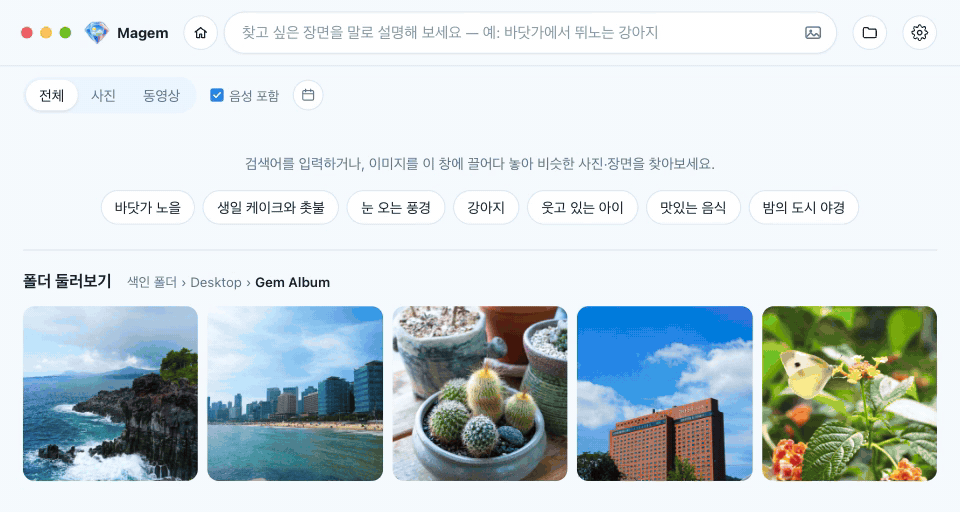

<p align="center"></p>

<h1 align="center">Magem</h1>

<p align="center">
  <b>클라우드 없이 내 컴퓨터에서만 동작하는 AI 기반 갤러리 앱</b><br>
  텍스트로 설명하면, 수천 장의 사진과 동영상 속 보석 같은 장면을 바로 찾아 줍니다.
</p>

<p align="center"><a href="https://github.com/Kokyung/Magem/releases"><b>다운로드(macOS, Windows)</b></a></p>

<p align="center"><b>한국어</b> · <a href="README.en.md">English</a> · <a href="README.ja.md">日本語</a> · <a href="README.zh-CN.md">简体中文</a> · <a href="README.zh-TW.md">繁體中文</a></p>

<p align="center"></p>

## 특징

- 🔒 **완전 로컬 환경**: AI 모델(Google EmbeddingGemma 2)이 앱 안에 들어 있습니다.
- 🛡️ **개인 정보 보호**: 사진이 컴퓨터 밖으로 나가지 않고, 계정·서버·클라우드 업로드도 없습니다.
- 🧠 **장면과 음성을 이해**: 사진·동영상의 장면과 동영상 속 음성을 이해해서 찾습니다.
- ⚡ **설치하면 바로 실행**: Python, Ollama, API 키가 필요 없습니다.
- 🌏 **17개 언어 지원**

## 기능

| 기능 | 설명 |
|---|---|
| 🔎 **문장으로 검색** | 찾고 싶은 장면을 텍스트로 설명 |
| 📅 **촬영일로 검색** | 달력에서 날짜 범위를 고르거나 빠른 선택(오늘·최근 7일·최근 30일·올해·작년)으로 고른 뒤 적용하면, 그 기간에 찍은 사진·동영상만 검색 |
| 🖼️ **이미지로 검색** | 버튼, 드래그 앤 드롭(웹 이미지 포함), 붙여넣기. 글자를 더해서 좁혀서 검색 |
| 🔊 **동영상 음성 찾기** | 대화, 음악, 환경음으로 검색. 찾은 장면의 시점부터 바로 재생 |
| 📁 **폴더 둘러보기** | 검색어 없이 폴더를 탐색. 이름·수정일 정렬. 아직 색인되지 않은 파일도 미리보기, 뷰어에서 감상 가능 |
| 🧩 **비슷한 항목 찾기** | 사진 하나를 골라 비슷한 사진·장면 찾기 |
| 🔍 **뷰어** | 사진 확대·이동, 전체 화면, 이전·다음 항목(버튼·화살표 키), 동영상 자동 재생 |
| 🔄 **자동 색인** | 새 파일과 바뀐 파일만 처리하고, 지운 파일은 색인에서 정리. 창을 닫아도 폴더 변화를 감지해 자동으로 색인. 하위 폴더 제외, ▶/⏸로 일시 중지 |
| 🔋 **색인 성능** | 앱 사용 중·백그라운드 각각 절전·균형·최고 성능 선택, 배터리 사용 중 색인 일시 중지 |
| 💾 **색인 백업·복원** | 색인과 썸네일을 `.magem` 파일 하나로 저장하고 되돌리기 |
| ⚙️ **설정** | 언어 17개, 시스템·라이트·다크 테마, 동영상 자동 재생, 시작할 때 자동 실행·백그라운드로 시작, 백그라운드로 실행(Windows) |

<details>
<summary>검색 결과와 색인 자세히</summary>

- **검색 결과**: "파일·폴더 이름"이 검색어와 맞는 항목을 맨 위에, 그 아래 "장면·음성"에 장면과 음성(음성 포함을 켠 경우)이
  비슷한 항목을 보여 줍니다. 한 파일은 둘 중 한 곳에만 나옵니다.
- **관련도(%)**: 검색 방식별로 보정한 0~100% 값이며, 40% 미만인 결과는 보여주지 않습니다.
- **촬영일**: 사진은 EXIF의 촬영 시각, 동영상은 파일에 기록된 생성 시각을 쓰고, 둘 다 없으면(스크린샷 등) 파일 수정일을 씁니다.
  검색어 없이 날짜만 고르면 그 기간의 항목을 최신순으로 보여 줍니다.
- **최근 검색어**: 최근 10개를 보여 주고, 하나씩 또는 전체를 지울 수 있습니다.
- **색인**: 파일 이름 분석 → 사진·영상 색인 순서로 진행합니다. 진행률은 ▶/⏸ 버튼 둘레의 링과 퍼센트로 보이고,
  버튼에 마우스를 올리면 남은 시간·처리 중인 파일·개수 같은 자세한 상태가 나옵니다.
  앱을 켤 때 새 파일을 확인하고, 실행 중에는 색인 폴더를 지켜보다가 파일이 추가·변경·삭제되면 자동으로 색인합니다
  (변경이 5초 동안 없을 때, 계속 이어지면 최대 60초 뒤). 창을 닫아 둔 상태에서도 동작하며, 이때 색인할 파일이 있으면 알림을 띄웁니다.
  ⏸로 멈추면 ▶을 누를 때까지 멈춰 있습니다.
- **색인 성능**: 앱을 쓰는 동안(기본 색인)과 창이 없거나 최소화됐을 때(백그라운드 실행 중 색인)를 따로 절전·균형·최고 성능 중에서
  고릅니다. 기본값은 균형과 절전이고, 배터리 사용 중 색인 일시 중지가 켜져 있습니다.
- **백그라운드 실행**: Windows에서는 창을 닫아도 트레이에 남아 색인을 이어 가며, 트레이 메뉴에서 열기·설정·색인 시작/일시 중지·종료를
  할 수 있습니다. macOS에서는 창을 닫아도 앱이 Dock에 남아 색인을 이어 가며, Dock 아이콘 메뉴에서 색인을 시작하거나 일시 중지할 수 있습니다.
- **색인 전 파일**: 폴더 둘러보기에서 아직 색인되지 않은 파일도 "색인 대기" 표시와 함께 미리보기 썸네일로 보여 주고, 뷰어로 열 수
  있습니다. 미리보기는 화면에 보이는 파일만 만들고, 색인이 끝나면 지웁니다.
- **폴더 개수**: 폴더 둘러보기의 폴더 버튼 숫자는 그 폴더 아래(하위 폴더 포함)에 지금 있는 사진·동영상 수입니다. 색인 여부와 관계없습니다.
- **색인 폴더 메뉴**: 색인 폴더와 제외한 폴더를 리스트나 그리드로 볼 수 있습니다.
- **언어**: 처음에는 OS 언어를 따르고, 목록에 없는 언어면 영어로 시작합니다. 오류 메시지는 언어와 관계없이 영어로 표시합니다.
- **지원 언어**: 영어, 한국어, 일본어, 중국어(간체·번체), 스페인어(스페인·중남미), 프랑스어, 이탈리아어, 독일어,
  러시아어, 우크라이나어, 폴란드어, 튀르키예어, 헝가리어, 체코어, 아랍어
- **동영상 복사**: 동영상은 "클립보드에 복사"(이미지로 복사)가 없습니다. 클립보드에는 동영상을 담는 공통 형식이 없어서,
  메신저나 탐색기에 붙여넣으려면 "파일 복사"를 쓰면 됩니다.
- **파일 선택이 풀리는 경우**: 선택한 파일을 복사하는 데 성공했을 때, Esc를 눌렀을 때, 검색어·필터·보고 있는 폴더가 바뀌었을 때.

</details>

## 설치

**[인스톨러 다운로드](https://github.com/Kokyung/Magem/releases)**

| 플랫폼 | 설치 파일 | 상태 |
|---|---|---|
| macOS (Apple Silicon) | `Magem-<버전>-mac-arm64.dmg` | 빌드·실행 확인 완료 |
| Windows (x64) | `Magem-<버전>-win-x64.exe` | 빌드·실행 확인 완료 |
| Windows (ARM64) | `Magem-<버전>-win-arm64.exe` | 빌드 설정만 있음 (빌드 테스트 확인 필요) |
| Linux (x64) | `Magem-<버전>-linux-x86_64.AppImage`, `Magem-<버전>-linux-amd64.deb` | 빌드 설정만 있음 (빌드 테스트 확인 필요) |

<details>
<summary>제한 사항</summary>

- Intel Mac은 지원하지 않습니다. onnxruntime이 Intel Mac용 네이티브 바이너리를 제공하지 않기 때문입니다.
- 개발자 인증서 없이 임시(ad-hoc) 서명한 빌드라서 다른 Mac에 처음 설치하면 Gatekeeper 경고가 뜹니다.
  Finder에서 앱을 **우클릭 → 열기**로 한 번 실행하면 됩니다. (빌드한 Mac에서는 경고가 뜨지 않습니다.)
- 같은 이유로 업데이트할 때마다 macOS가 폴더 접근 권한을 다시 묻습니다. 임시 서명은 앱 내용의 해시가
  곧 앱의 신원이라 버전이 바뀌면 다른 앱으로 인식되기 때문입니다. Developer ID 인증서로 서명하면 사라집니다.
- 같은 이유로 macOS에서는 백그라운드 색인 알림이 표시되지 않습니다. macOS는 임시 서명한 앱의 알림을 허용하지 않습니다.
  (Windows에서는 화면 오른쪽 아래에 표시됩니다.)
- Windows 설치 파일도 코드 서명이 없어서 처음 실행할 때 SmartScreen 경고가 뜰 수 있습니다.
  **추가 정보 → 실행**을 누르면 됩니다.

</details>

## 문서

- [크기 제한](docs/LIMITS.md): 색인·검색·복사에 걸리는 크기 제한
- [구조](docs/ARCHITECTURE.md): 코드 구성, 임베딩 엔진, 데이터·로그 위치

## 개발 / 빌드

Node.js 22.12 이상이 필요합니다.

```bash
npm install          # 의존성 설치 + 모델 다운로드(약 1.2GB)
npm start            # 개발 모드로 실행
npm run dist:mac     # macOS DMG  → dist/
npm run dist:win:x64   # Windows x64 설치 파일 (Windows에서 실행)
npm run dist:win:arm64 # Windows ARM64 설치 파일 (Windows에서 실행, ARM64용 ffmpeg를 먼저 내려받음)
npm run dist:win       # 위 두 설치 파일을 차례로 빌드
npm run dist:linux   # AppImage / deb (Linux에서 실행)
npm run make-icons   # build/icon-source.png에서 앱 아이콘과 타이틀 로고(static/logo.png)를 다시 생성
```

Windows 설치 파일은 **Windows에서** 빌드해야 합니다. sharp·ONNX Runtime·ffmpeg는 OS와 CPU마다 다른 바이너리를 쓰는데, `npm install`은 빌드하는 컴퓨터용만 설치합니다. 그래서 macOS에서 만든 Windows 설치 파일에는 macOS용 바이너리가 들어가 동작하지 않습니다.

x64 PC에서 ARM64 설치 파일을 만들 때는 먼저 ARM64용 sharp를 설치하세요(ONNX Runtime은 두 CPU용이 함께 설치되고, ffmpeg는 `dist:win:arm64`가 내려받습니다).

```bash
npm install --no-save --os=win32 --cpu=arm64 sharp
```

### 모델 받기 (EmbeddingGemma 2)

모델 파일은 저장소에 들어 있지 않습니다(`models/`는 `.gitignore`에 포함). `npm install`이 끝나면
`scripts/fetch-model.mjs`가 자동으로 실행되어 Hugging Face에서 필요한 파일만 내려받습니다.
로그인이나 토큰은 필요 없습니다.

```
models/
├─ embeddinggemma-2-ONNX/   onnx-community/embeddinggemma-2-ONNX (약 1.2GB)
│  ├─ config.json, tokenizer.json 등 설정 파일
│  └─ onnx/  model_fp16 · vision_encoder_fp16 · audio_encoder_quantized (.onnx + .onnx_data)
```

- 다운로드가 중간에 끊겼거나 파일이 빠졌다면 `npm run fetch-model`로 다시 실행하세요.
  이미 받은 파일은 크기를 비교해서 건너뛰고, 크기가 다른 파일은 다시 받습니다.
- `npm install --ignore-scripts`로 설치했다면 자동 다운로드가 실행되지 않으니 `npm run fetch-model`을 직접 실행하세요.
- 앱은 실행 중에 인터넷에서 모델을 받지 않고 `models/` 폴더만 사용합니다. 빌드할 때 이 폴더가 설치 파일에
  그대로 들어가므로, 빌드 전에 모델이 준비되어 있어야 합니다.
- 받을 파일 목록과 정밀도(fp16·q8)는 `backend/embedder.mjs`의 `DTYPE`과 맞춰져 있습니다.
  정밀도를 바꾸면 `scripts/fetch-model.mjs`의 `FILES`도 함께 바꿔야 합니다.

### 플랫폼별 빌드

각 플랫폼 설치 파일은 해당 OS에서 빌드해야 합니다.
네이티브 모듈(onnxruntime-node, sharp)과 ffmpeg 바이너리가 빌드하는 OS에 맞춰 설치되기 때문입니다.

Windows ARM64용 ffmpeg는 `scripts/fetch-ffmpeg.mjs`가 BtbN의 고정된 빌드를 내려받고 SHA-256을 확인합니다.
BtbN은 오래된 빌드를 지우므로 고정 빌드가 사라지면 다음 중 하나로 진행하세요.

```bash
FFMPEG_WINARM64_URL=<같은 zip의 사본 주소> npm run fetch-ffmpeg   # SHA-256 검사는 그대로 적용
node scripts/fetch-ffmpeg.mjs --latest                             # BtbN 최신 LGPL 빌드 (해시 고정 없음)
```

## 자주 묻는 질문

<details>
<summary><b>인터넷 연결이 필요한가요?</b></summary>

필요 없습니다. AI 모델이 앱 안에 들어 있어서 색인, 검색, 미리보기를 포함한 모든 기본 기능이 인터넷 연결 없이 동작합니다.
일부 실험적 기능은 인터넷 연결이 필요할 수 있지만, 사용하지 않아도 앱은 그대로 작동합니다.
웹 페이지에서 이미지를 끌어다 검색할 때는 그 이미지를 내려받습니다.
어떤 경우에도 사진·동영상 데이터를 업로드하지 않습니다.

</details>

<details>
<summary><b>내 파일은 수정되거나 삭제되나요?</b></summary>

아니요. Magem은 원본 사진과 동영상을 읽기만 하고, 수정하거나 삭제하지 않습니다.
색인·썸네일·미리보기는 원본과 따로 앱 데이터 폴더에 저장됩니다.
색인 폴더를 목록에서 빼거나 폴더를 제외해도 색인에서만 빠질 뿐, 원본 파일은 그대로 남습니다.

</details>

## 라이선스

Copyright 2026 Kokyung Byun

| 구성 요소 | 라이선스 | 비고 |
|---|---|---|
| Magem | Apache-2.0 | [LICENSE](LICENSE) |
| EmbeddingGemma 2 모델 | Apache-2.0 | |
| ffmpeg (macOS, Windows x64, Linux) | GPL-3.0 | 별도 프로그램으로 실행 · 재배포 시 GPL 조건 적용 · [소스](https://ffmpeg.org/download.html) |
| ffmpeg (Windows ARM64) | LGPL | BtbN 빌드 · 버전·SHA-256은 `scripts/fetch-ffmpeg.mjs`에 고정 |
| 그 밖의 라이브러리 | 각 라이선스 | [THIRD_PARTY_NOTICES.md](THIRD_PARTY_NOTICES.md) |
