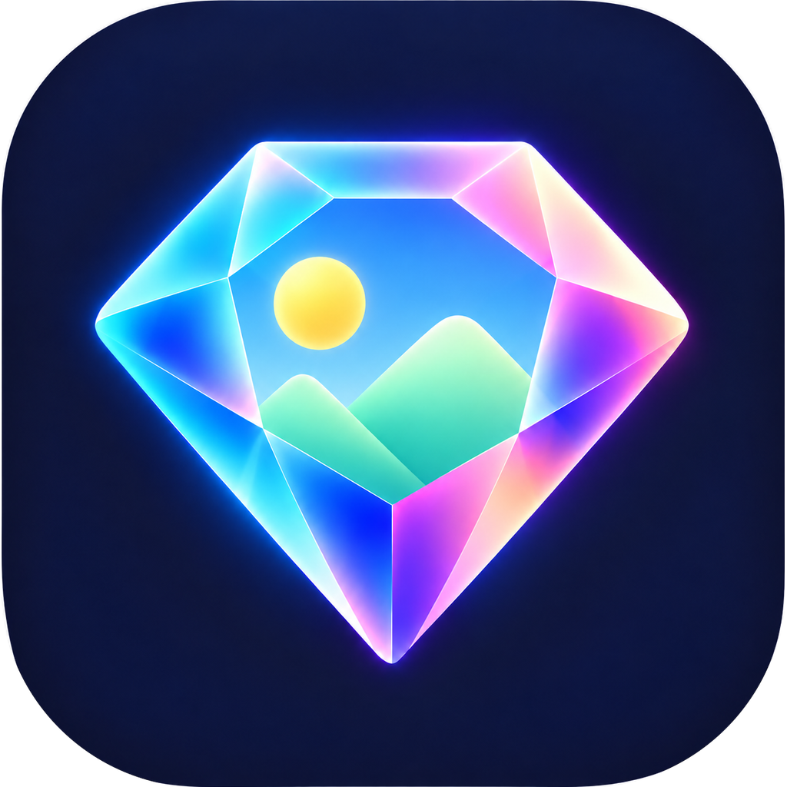
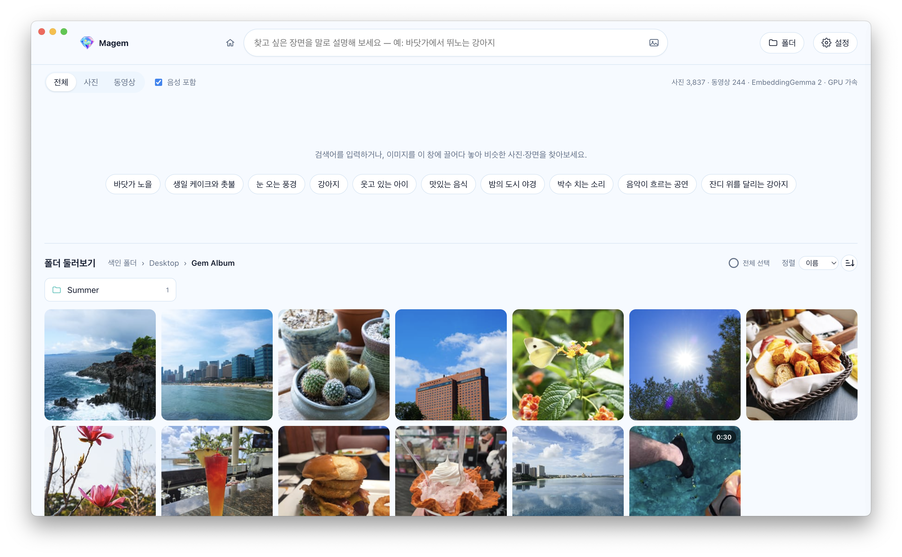

<p align="center"></p>

<h1 align="center">Magem</h1>

<p align="center">
  <b>인터넷 없이 내 컴퓨터에서만 동작하는 AI 사진·동영상 검색 앱</b><br>
  텍스트로 설명하면, 수천 장의 사진과 동영상 속 보석 같은 장면을 바로 찾아 줍니다.
</p>

<p align="center"><a href="https://github.com/Kokyung/Magem/releases"><b>다운로드(macOS, Windows)</b></a></p>

<p align="center"></p>

## 특징

- 🔒 **완전 오프라인**: AI 모델(Google EmbeddingGemma 2)이 앱 안에 들어 있습니다. 
- 🛡️ **개인 정보 보호**: 사진이 컴퓨터 밖으로 나가지 않고, 계정·서버·클라우드 업로드도 없습니다.
- 🧠 **파일 이름이 아니라 내용으로 검색**: 사진의 장면, 사진 속 글자, 동영상 속 음성까지 이해해서 찾습니다.
- ⚡ **설치하면 바로 실행**: Python, Ollama, API 키가 필요 없습니다. GPU가 있으면 자동으로 가속합니다.
- 🌏 **17개 언어 지원**

## 기능

| 기능 | 설명 |
|---|---|
| 🔎 **문장으로 검색** | 찾고 싶은 장면을 텍스트로 설명 |
| 🖼️ **이미지로 검색** | 버튼, 드래그 앤 드롭(웹 이미지 포함), 붙여넣기. 글자를 더해서 좁혀서 검색 |
| 🔤 **사진 속 글자** | 간판, 문서, 스크린샷, 자막에 보이는 글자(OCR)로 검색 |
| 🔊 **동영상 음성** | 대화, 음악, 환경음으로 검색. 찾은 장면의 시점부터 바로 재생 |
| 📁 **폴더 둘러보기** | 검색어 없이 폴더를 탐색. 이름·수정일 정렬 |
| 🧩 **비슷한 항목 찾기** | 사진 하나를 골라 비슷한 사진·장면 찾기 |
| 🔄 **자동 색인** | 새 파일과 바뀐 파일만 처리하고, 지운 파일은 색인에서 정리. 하위 폴더 제외 가능 |
| ⚙️ **설정** | 언어 17개, 시스템·라이트·다크 테마 |

<details>
<summary>검색 결과와 색인 자세히</summary>

- **관련도 순 드롭다운**: 텍스트로 검색하면 검색창 아래에 표시되고, 고른 기준은 기억합니다.
  - **이미지**: 사진·영상 장면이 검색어와 비슷한 순서 (음성 포함을 켜면 동영상 음성도 반영)
  - **텍스트**: 파일·폴더 이름 / 사진 속 글자 / 음성(대사) 세 묶음으로 나눠 표시
- **관련도(%)**: 검색 방식별로 보정한 0~100% 값이며, 40% 미만인 결과는 보여주지 않습니다.
- **최근 검색어**: 최근 10개를 보여 주고, 하나씩 또는 전체를 지울 수 있습니다.
- **색인 순서**: 파일 이름 분석 → 사진·영상 색인 → 사진 속 글자 인식(사진 1장에 약 0.3초, 백그라운드 처리).
- **언어**: 처음에는 OS 언어를 따르고, 목록에 없는 언어면 영어로 시작합니다. 오류 메시지는 언어와 관계없이 영어로 표시합니다.
- **지원 언어**: 영어, 한국어, 일본어, 중국어(간체·번체), 스페인어(스페인·중남미), 프랑스어, 이탈리아어, 독일어,
  러시아어, 우크라이나어, 폴란드어, 튀르키예어, 헝가리어, 체코어, 아랍어
- **동영상 복사**: 동영상은 "클립보드에 복사"(이미지로 복사)가 없습니다. 클립보드에는 동영상을 담는 공통 형식이 없어서,
  메신저나 탐색기에 붙여넣으려면 "파일 복사"를 쓰면 됩니다.
- **파일 선택이 풀리는 경우**: 선택한 파일을 복사하는 데 성공했을 때, Esc를 눌렀을 때, 검색어·필터·보고 있는 폴더가 바뀌었을 때.

</details>

## 설치

**[인스톨러 다운로드](https://github.com/Kokyung/Magem/releases)**

| 플랫폼 | 설치 파일 | 상태 |
|---|---|---|
| macOS (Apple Silicon) | `Magem-<버전>-arm64.dmg` | 빌드·실행 확인 완료 |
| Windows (x64 / ARM64) | `Magem Setup <버전>.exe` | 빌드·실행 확인 완료 |
| Linux (x64) | `.AppImage`, `.deb` | 빌드 설정만 있음 (Linux에서 빌드 필요, 미검증) |

- Intel Mac은 지원하지 않습니다. onnxruntime이 Intel Mac용 네이티브 바이너리를 제공하지 않기 때문입니다.
- 개발자 인증서 없이 임시(ad-hoc) 서명한 빌드라서 다른 Mac에 처음 설치하면 Gatekeeper 경고가 뜹니다.
  Finder에서 앱을 **우클릭 → 열기**로 한 번 실행하면 됩니다. (빌드한 Mac에서는 경고가 뜨지 않습니다.)
- 같은 이유로 업데이트할 때마다 macOS가 폴더 접근 권한을 다시 묻습니다. 임시 서명은 앱 내용의 해시가
  곧 앱의 신원이라 버전이 바뀌면 다른 앱으로 인식되기 때문입니다. Developer ID 인증서로 서명하면 사라집니다.
- Windows 설치 파일도 코드 서명이 없어서 처음 실행할 때 SmartScreen 경고가 뜰 수 있습니다.
  **추가 정보 → 실행**을 누르면 됩니다.


## 크기 제한

| 항목 | 제한 | 넘으면 |
|---|---|---|
| 색인할 사진 | 약 2억 6,800만 화소 (예: 16,384 × 16,384) | 색인하지 않고 폴더 창의 "처리하지 못한 파일"에 표시 |
| 이미지로 검색 (파일 선택·드래그·붙여넣기) | 64MB | 검색 실패 메시지 표시 |
| 웹 브라우저에서 끌어온 이미지 | 25MB, 다운로드 20초 | "The image is too large" 등 오류 표시 |
| 파일 복사 (여러 파일 선택) | 한 번에 10,000개 | 안내 메시지를 보여 주고 선택은 그대로 유지 |
| 클립보드에 사진 복사 | 긴 변 8,192px | 그보다 크면 8,192px로 줄여서 복사 (원본 파일은 그대로) |

- 화소 제한은 이미지 처리 라이브러리(sharp)의 기본 안전 장치로, 일반 카메라·스마트폰 사진(1억 화소대 이하)은 해당하지 않습니다.
- 동영상은 파일 크기 제한이 없습니다. 대신 길이에 따라 2~30초 간격으로 최대 120장의 프레임만 색인합니다.

## 구조

```
electron/main.mjs      창·폴더 선택 대화상자·Finder 연동·클립보드·시스템 트레이·자동 실행 (메인 프로세스)
electron/preload.cjs   렌더러에 노출하는 최소 API
                       화면: pickFolders, setTheme, systemLanguages
                       파일: reveal, revealFolder, openFile, copyImage, copyFiles, copyPaths
                       앱 설정: getAppSettings, setOpenAtLogin, setRunInBackground, setTrayLabels, onOpenSettings
backend/               검색 엔진 (Electron utilityProcess에서 실행)
  embedder.mjs         EmbeddingGemma 2 ONNX — transformers.js + onnxruntime-node
  ocr.mjs              사진 속 글자 인식 — PaddleOCR PP-OCRv5 (검출 + 한국어/영문 인식) ONNX
  media.mjs            사진·영상·오디오 디코딩 (sharp, ffmpeg-static, macOS sips, heic-decode)
  indexer.mjs          폴더 스캔, 색인, 벡터 검색 (node:sqlite)
  server.mjs           127.0.0.1 HTTP API + UI (실행할 때마다 바뀌는 토큰 쿠키로 보호)
static/                UI (HTML/CSS/JS), i18n.js에 화면 문구 17개 언어
build/                 앱 아이콘 (icon-source.png 원본 → npm run make-icons로 생성)
models/                번들에 들어가는 모델 파일 (npm install 시 자동 다운로드)
```

### 임베딩 엔진
- 모델은 `onnx-community/embeddinggemma-2-ONNX`(Apache 2.0)이고, OCR은 PaddleOCR PP-OCRv5(Apache 2.0, 약 18MB)입니다.
  텍스트와 비전은 fp16, 오디오는 q8 정밀도이고, 앱에 포함되는 용량은 약 1.2GB입니다.
- 실행 장치는 GPU를 먼저 시도하고, 안 되면 CPU로 자동 전환합니다.
  - macOS/Linux: WebGPU → CPU
  - Windows: WebGPU → DirectML → CPU
  - `MMF_DEVICE=cpu`로 강제할 수 있습니다.
- 속도 (M2 Pro 측정): WebGPU에서 사진 1장 약 0.55초, CPU만 쓰면 약 2.8초입니다.
- 동영상은 2~30초 간격 프레임(최대 120장)과 15초 단위 오디오 조각으로 나눠 임베딩합니다.
  무음 조각은 건너뜁니다.
- 텍스트 검색에서는 각 벡터가 일반적인 쿼리들과 얼마나 비슷한지(baseline)를 빼서 보정한 뒤,
  관련도(%)가 40% 미만인 결과는 검색 결과에서 제외합니다.
- 파일·폴더 이름과 사진 속 글자는 `title: … | text: …` 문서 형식으로 임베딩합니다.
  점수는 의미 유사도에 키워드 일치(검색어 단어 중 텍스트에 들어 있는 비율 × 0.2)를 더해 계산합니다.
  OCR 텍스트가 길면 의미 점수만으로는 정확한 단어가 묻히기 때문입니다.
- macOS의 한글 파일 이름은 자모가 분리된 NFD 형식으로 저장되므로, 이름과 검색어를 NFC로 정규화해서 비교합니다.

### 데이터 위치
색인(SQLite)과 썸네일은 앱 데이터 폴더에 저장됩니다.

| 플랫폼 | 경로 |
|---|---|
| macOS | `~/Library/Application Support/Magem/` |
| Windows | `%APPDATA%\Magem\` |
| Linux | `~/.config/Magem/` |

로그는 같은 폴더의 `logs/`에 남습니다.

- `engine.log`: 검색 엔진 로그 (직전 실행분은 `engine.prev.log`)
- `main.log`: 화면·GPU·네트워크 프로세스 종료와 자동 복구, 잠자기·깨우기 기록 (누적)

## 개발 / 빌드

Node.js 22.12 이상이 필요합니다.

```bash
npm install          # 의존성 설치 + 모델 다운로드(약 1.2GB)
npm start            # 개발 모드로 실행
npm run dist:mac     # macOS DMG  → dist/
npm run dist:win     # Windows 설치 파일 x64·ARM64 (Windows에서 실행, ARM64용 ffmpeg를 먼저 내려받음)
npm run dist:linux   # AppImage / deb (Linux에서 실행)
npm run make-icons   # build/icon-source.png에서 앱 아이콘과 타이틀 로고(static/logo.png)를 다시 생성
```

### 모델 받기 (EmbeddingGemma 2, PaddleOCR)

모델 파일은 저장소에 들어 있지 않습니다(`models/`는 `.gitignore`에 포함). `npm install`이 끝나면
`scripts/fetch-model.mjs`가 자동으로 실행되어 Hugging Face에서 필요한 파일만 내려받습니다.
로그인이나 토큰은 필요 없습니다.

```
models/
├─ embeddinggemma-2-ONNX/   onnx-community/embeddinggemma-2-ONNX (약 1.2GB)
│  ├─ config.json, tokenizer.json 등 설정 파일
│  └─ onnx/  model_fp16 · vision_encoder_fp16 · audio_encoder_quantized (.onnx + .onnx_data)
└─ ocr/                     PaddleOCR PP-OCRv5 (약 18MB)
   ├─ det.onnx              PaddlePaddle/PP-OCRv5_mobile_det_onnx
   └─ rec.onnx, rec.yml     PaddlePaddle/korean_PP-OCRv5_mobile_rec_onnx
```

- 다운로드가 중간에 끊겼거나 파일이 빠졌다면 `npm run fetch-model`로 다시 실행하세요.
  이미 받은 파일은 건너뜁니다(임베딩 모델은 크기까지 비교해서, 크기가 다른 파일은 다시 받습니다).
  OCR 파일이 손상된 것 같으면 `models/ocr/`를 지우고 다시 실행하세요.
- `npm install --ignore-scripts`로 설치했다면 자동 다운로드가 실행되지 않으니 `npm run fetch-model`을 직접 실행하세요.
- 앱은 실행 중에 인터넷에서 모델을 받지 않고 `models/` 폴더만 사용합니다. 빌드할 때 이 폴더가 설치 파일에
  그대로 들어가므로, 빌드 전에 모델이 준비되어 있어야 합니다.
- 받을 파일 목록과 정밀도(fp16·q8)는 `backend/embedder.mjs`의 `DTYPE`과 맞춰져 있습니다.
  정밀도를 바꾸면 `scripts/fetch-model.mjs`의 `FILES`도 함께 바꿔야 합니다.

### 플랫폼별 빌드

각 플랫폼 설치 파일은 해당 OS에서 빌드해야 합니다.
네이티브 모듈(onnxruntime-node, sharp)과 ffmpeg 바이너리가 빌드하는 OS에 맞춰 설치되기 때문입니다.

Windows ARM64용 ffmpeg는 `scripts/fetch-ffmpeg.mjs`가 BtbN의 고정된 빌드를 내려받고 SHA-256을 확인합니다.
BtbN은 오래된 빌드를 지우므로 고정 빌드가 사라지면 다음 중 하나로 진행하세요.

```bash
FFMPEG_WINARM64_URL=<같은 zip의 사본 주소> npm run fetch-ffmpeg   # SHA-256 검사는 그대로 적용
node scripts/fetch-ffmpeg.mjs --latest                             # BtbN 최신 LGPL 빌드 (해시 고정 없음)
```

## 라이선스

Copyright 2026 Kokyung Byun

| 구성 요소 | 라이선스 | 비고 |
|---|---|---|
| Magem | Apache-2.0 | [LICENSE](LICENSE) |
| EmbeddingGemma 2, PaddleOCR 모델 | Apache-2.0 | |
| ffmpeg (macOS, Windows x64, Linux) | GPL-3.0 | 별도 프로그램으로 실행 · 재배포 시 GPL 조건 적용 · [소스](https://ffmpeg.org/download.html) |
| ffmpeg (Windows ARM64) | LGPL | BtbN 빌드 · 버전·SHA-256은 `scripts/fetch-ffmpeg.mjs`에 고정 |
| 그 밖의 라이브러리 | 각 라이선스 | [THIRD_PARTY_NOTICES.md](THIRD_PARTY_NOTICES.md) |
