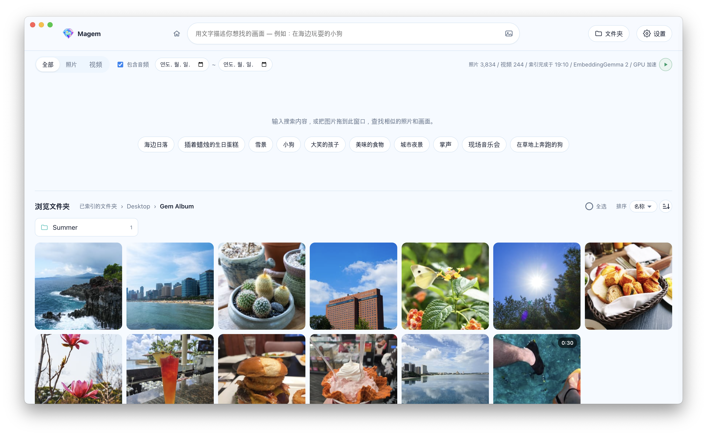

<p align="center"></p>

<h1 align="center">Magem</h1>

<p align="center">
  <b>无需联网、只在你的电脑上运行的 AI 相册应用</b><br>
  用文字描述，就能在成千上万的照片和视频中立刻找到宝石般的画面。
</p>

<p align="center"><a href="https://github.com/Kokyung/Magem/releases"><b>下载（macOS、Windows）</b></a></p>

<p align="center"><a href="README.md">한국어</a> · <a href="README.en.md">English</a> · <a href="README.ja.md">日本語</a> · <b>简体中文</b> · <a href="README.zh-TW.md">繁體中文</a></p>

<p align="center"></p>

## 特点

- 🔒 **完全离线**：AI 模型（Google EmbeddingGemma 2）内置在应用中。
- 🛡️ **保护隐私**：照片不会离开你的电脑，也没有账号、服务器或云端上传。
- 🧠 **按内容而非文件名搜索**：理解照片和视频中的画面以及视频中的声音来查找。
- ⚡ **安装即用**：无需 Python、Ollama 或 API 密钥。有 GPU 时自动加速。
- 🌏 **支持 17 种语言**

## 功能

| 功能 | 说明 |
|---|---|
| 🔎 **用句子搜索** | 用文字描述想找的画面 |
| 📅 **按拍摄日期搜索** | 选择日期范围，只搜索该期间拍摄的照片和视频 |
| 🖼️ **以图搜索** | 按钮、拖放（包括网页图片）、粘贴。可加上文字缩小范围 |
| 🔊 **查找视频中的声音** | 按对话、音乐、环境音搜索。从找到的画面时间点直接播放 |
| 📁 **浏览文件夹** | 无需搜索词即可浏览文件夹。按名称、修改日期排序 |
| 🧩 **查找相似项** | 选择一张照片，查找相似的照片和画面 |
| 🔄 **自动索引** | 只处理新增和更改的文件，并从索引中清理已删除的文件。可排除子文件夹，用 ▶/⏸ 暂停 |
| 💾 **索引备份与恢复** | 将索引和缩略图保存为一个 `.magem` 文件，并可还原 |
| ⚙️ **设置** | 17 种语言，系统 / 浅色 / 深色主题 |

<details>
<summary>搜索结果与索引详情</summary>

- **搜索结果**：在最上方的“文件和文件夹名”中显示名称与搜索词匹配的项目，下方的“画面·音频”中显示画面和声音（开启“包含音频”时）
  相似的项目。一个文件只会出现在其中一处。
- **相关度（%）**：按搜索方式校准的 0~100% 数值，低于 40% 的结果不显示。
- **拍摄日期**：照片使用 EXIF 拍摄时间，视频使用文件中记录的创建时间；两者都没有时（如截图）使用文件修改日期。
  不输入搜索词只选日期时，会按从新到旧显示该期间的项目。
- **最近搜索**：显示最近 10 条，可逐条或全部删除。
- **索引**：按文件名分析 → 照片和视频索引的顺序进行，索引期间显示剩余时间。
  在启动应用时，以及从其他应用回到窗口时（最多每 30 秒一次）检查新文件。按 ⏸ 暂停后，会一直暂停直到按下 ▶。
- **语言**：默认跟随系统语言，若该语言不在列表中则以英语启动。错误信息无论语言设置如何都以英语显示。
- **支持的语言**：英语、韩语、日语、中文（简体、繁体）、西班牙语（西班牙、拉丁美洲）、法语、意大利语、德语、
  俄语、乌克兰语、波兰语、土耳其语、匈牙利语、捷克语、阿拉伯语
- **复制视频**：视频没有“复制到剪贴板”（作为图片复制）。剪贴板没有存放视频的通用格式，
  如需粘贴到聊天软件或文件管理器，请使用“复制文件”。
- **文件选择被取消的情况**：成功复制所选文件后、按下 Esc 时、搜索词·筛选条件·正在查看的文件夹发生变化时。

</details>

## 安装

**[下载安装程序](https://github.com/Kokyung/Magem/releases)**

| 平台 | 安装文件 | 状态 |
|---|---|---|
| macOS（Apple Silicon） | `Magem-<版本>-mac-arm64.dmg` | 已构建并验证运行 |
| Windows（x64） | `Magem-<版本>-win-x64.exe` | 已构建并验证运行 |
| Windows（ARM64） | `Magem-<版本>-win-arm64.exe` | 已构建并验证运行 |
| Linux（x64） | `Magem-<版本>-linux-x86_64.AppImage`、`Magem-<版本>-linux-amd64.deb` | 仅有构建配置（需在 Linux 上构建，未验证） |

- 不支持 Intel Mac，因为 onnxruntime 不提供 Intel Mac 的原生二进制文件。
- 此构建未使用开发者证书，而是临时（ad-hoc）签名，因此首次在其他 Mac 上安装时会出现 Gatekeeper 警告。
  在 Finder 中 **右键点击应用 → 打开** 运行一次即可。（在构建它的 Mac 上不会出现警告。）
- 出于同样原因，每次更新后 macOS 都会再次请求文件夹访问权限。临时签名以应用内容的哈希作为应用身份，
  版本变化后会被视为另一个应用。使用 Developer ID 证书签名即可解决。
- Windows 安装程序同样没有代码签名，首次运行时可能出现 SmartScreen 警告。
  点击 **更多信息 → 仍要运行** 即可。

## 大小限制

| 项目 | 限制 | 超出时 |
|---|---|---|
| 要索引的照片 | 约 2.68 亿像素（例：16,384 × 16,384） | 不索引，并显示在文件夹面板的“无法处理的文件”中 |
| 以图搜索（选择文件、拖放、粘贴） | 64MB | 显示搜索失败信息 |
| 从网页浏览器拖入的图片 | 25MB，下载 20 秒 | 显示“The image is too large”等错误 |
| 复制文件（多选） | 一次 10,000 个 | 显示提示信息，并保留选择 |
| 将照片复制到剪贴板 | 长边 8,192px | 更大的照片会缩小到 8,192px 后复制（原文件不变） |

- 像素限制是图像处理库（sharp）的默认安全措施，普通相机和手机照片（1 亿像素级及以下）不受影响。
- 视频没有文件大小限制。但会根据时长每隔 2~30 秒取帧，最多只索引 120 帧。

## 结构

```
electron/main.mjs      窗口、文件夹选择对话框、Finder 集成、剪贴板、文件拖动、系统托盘、开机启动（主进程）
electron/index-backup.mjs  索引备份（.magem）与恢复 — 恢复会在下次启动、引擎启动之前替换
electron/preload.cjs   向渲染进程暴露的最小 API
                       界面：pickFolders, setTheme, systemLanguages
                       文件：reveal, revealFolder, openFile, copyImage, copyFiles, copyPaths, startFileDrag, pathForFile
                       备份：startBackup, startRestore, cancelIndexJob, getIndexJob, revealBackup, onIndexJob
                       应用设置：getAppSettings, setOpenAtLogin, setRunInBackground, setTrayLabels, onOpenSettings
backend/               搜索引擎（在 Electron utilityProcess 中运行）
  embedder.mjs         EmbeddingGemma 2 ONNX — transformers.js + onnxruntime-node
  media.mjs            照片、视频、音频解码（sharp, ffmpeg-static, macOS sips, heic-decode）
  indexer.mjs          文件夹扫描、索引、向量搜索、剩余时间估算（node:sqlite）
  server.mjs           127.0.0.1 HTTP API + UI（由每次启动都会变化的令牌 Cookie 保护）
  db-check.mjs         检查要恢复的备份索引（完整性、表、缩略图名称）
static/                UI（HTML/CSS/JS），i18n.js 中包含 17 种语言的界面文字
build/                 应用图标（由原图 icon-source.png 通过 npm run make-icons 生成）
models/                打包进应用的模型文件（npm install 时自动下载）
```

### 嵌入引擎
- 模型为 `onnx-community/embeddinggemma-2-ONNX`（Apache 2.0）。
  文本和视觉为 fp16 精度，音频为 q8 精度，在应用中约占 1.2GB。
- 运行设备会先尝试 GPU，不可用时自动切换到 CPU。
  - macOS/Linux：WebGPU → CPU
  - Windows：WebGPU → DirectML → CPU
  - 可用 `MMF_DEVICE=cpu` 强制使用 CPU。
- 速度（在 M2 Pro 上测得）：WebGPU 每张照片约 0.55 秒，仅用 CPU 约 2.8 秒。
- 视频会拆分为每隔 2~30 秒的帧（最多 120 帧）和 15 秒一段的音频片段进行嵌入。
  静音片段会被跳过。
- 文本搜索会减去每个向量与通用查询的相似程度（baseline）进行校准，
  然后从结果中排除相关度（%）低于 40% 的项目。
- 文件和文件夹名以 `title: … | text: …` 文档格式嵌入。
  分数为语义相似度加上关键词匹配（搜索词中出现在名称里的词所占比例 × 0.2），
  因为仅靠语义分数，像“INFP”这样查找精确单词的搜索可能会被淹没。
- macOS 以字母分解的 NFD 形式保存韩文文件名，因此会将名称和搜索词规范化为 NFC 后再比较。

### 数据位置
索引（SQLite）和缩略图保存在应用数据文件夹中。

| 平台 | 路径 |
|---|---|
| macOS | `~/Library/Application Support/Magem/` |
| Windows | `%APPDATA%\Magem\` |
| Linux | `~/.config/Magem/` |

日志保存在同一文件夹的 `logs/` 中。

- `engine.log`：搜索引擎日志（上一次运行的日志在 `engine.prev.log`）
- `main.log`：界面、GPU、网络进程的退出与自动恢复，以及睡眠和唤醒记录（累积）

## 开发 / 构建

需要 Node.js 22.12 或更高版本。

```bash
npm install          # 安装依赖 + 下载模型（约 1.2GB）
npm start            # 以开发模式运行
npm run dist:mac     # macOS DMG  → dist/
npm run dist:win:x64   # Windows x64 安装程序（在 Windows 上运行）
npm run dist:win:arm64 # Windows ARM64 安装程序（在 Windows 上运行，会先下载 ARM64 版 ffmpeg）
npm run dist:win       # 依次构建以上两个安装程序
npm run dist:linux   # AppImage / deb（在 Linux 上运行）
npm run make-icons   # 从 build/icon-source.png 重新生成应用图标和标题 Logo（static/logo.png）
```

Windows 安装程序需要**在 Windows 上**构建。sharp、ONNX Runtime 和 ffmpeg 针对不同的操作系统和 CPU 使用不同的二进制文件，而 `npm install` 只安装当前电脑所需的版本，因此在 macOS 上生成的 Windows 安装程序会包含 macOS 二进制文件，无法运行。

在 x64 电脑上构建 ARM64 安装程序时，请先安装 ARM64 版 sharp（ONNX Runtime 已包含两种 CPU 的版本，ffmpeg 由 `dist:win:arm64` 下载）：

```bash
npm install --no-save --os=win32 --cpu=arm64 sharp
```

### 获取模型（EmbeddingGemma 2）

模型文件不在仓库中（`models/` 已列入 `.gitignore`）。`npm install` 完成后，
`scripts/fetch-model.mjs` 会自动运行，只从 Hugging Face 下载所需文件。
无需登录或令牌。

```
models/
├─ embeddinggemma-2-ONNX/   onnx-community/embeddinggemma-2-ONNX（约 1.2GB）
│  ├─ config.json、tokenizer.json 等配置文件
│  └─ onnx/  model_fp16 · vision_encoder_fp16 · audio_encoder_quantized (.onnx + .onnx_data)
```

- 如果下载中断或缺少文件，请再次运行 `npm run fetch-model`。
  已下载的文件会通过比较大小跳过，大小不同的文件会重新下载。
- 如果使用 `npm install --ignore-scripts` 安装，自动下载不会运行，请手动运行 `npm run fetch-model`。
- 应用运行时不会从网络下载模型，只使用 `models/` 文件夹。构建时该文件夹会原样打包进安装程序，
  因此构建前必须先准备好模型。
- 下载的文件列表和精度（fp16、q8）与 `backend/embedder.mjs` 中的 `DTYPE` 保持一致。
  如果更改精度，也需要同时修改 `scripts/fetch-model.mjs` 中的 `FILES`。

### 各平台构建

各平台的安装程序必须在对应的操作系统上构建，
因为原生模块（onnxruntime-node、sharp）和 ffmpeg 二进制文件会按构建所在的操作系统安装。

Windows ARM64 版 ffmpeg 由 `scripts/fetch-ffmpeg.mjs` 下载 BtbN 的固定构建，并校验 SHA-256。
BtbN 会删除旧的构建，如果固定构建已不存在，请选择以下任一方式。

```bash
FFMPEG_WINARM64_URL=<同一 zip 的镜像地址> npm run fetch-ffmpeg   # 仍会进行 SHA-256 校验
node scripts/fetch-ffmpeg.mjs --latest                             # BtbN 最新 LGPL 构建（不固定哈希）
```

## 许可证

Copyright 2026 Kokyung Byun

| 组件 | 许可证 | 备注 |
|---|---|---|
| Magem | Apache-2.0 | [LICENSE](LICENSE) |
| EmbeddingGemma 2 模型 | Apache-2.0 | |
| ffmpeg（macOS、Windows x64、Linux） | GPL-3.0 | 作为独立程序运行 · 再分发时适用 GPL 条款 · [源代码](https://ffmpeg.org/download.html) |
| ffmpeg（Windows ARM64） | LGPL | BtbN 构建 · 版本和 SHA-256 固定在 `scripts/fetch-ffmpeg.mjs` 中 |
| 其他库 | 各自的许可证 | [THIRD_PARTY_NOTICES.md](THIRD_PARTY_NOTICES.md) |
